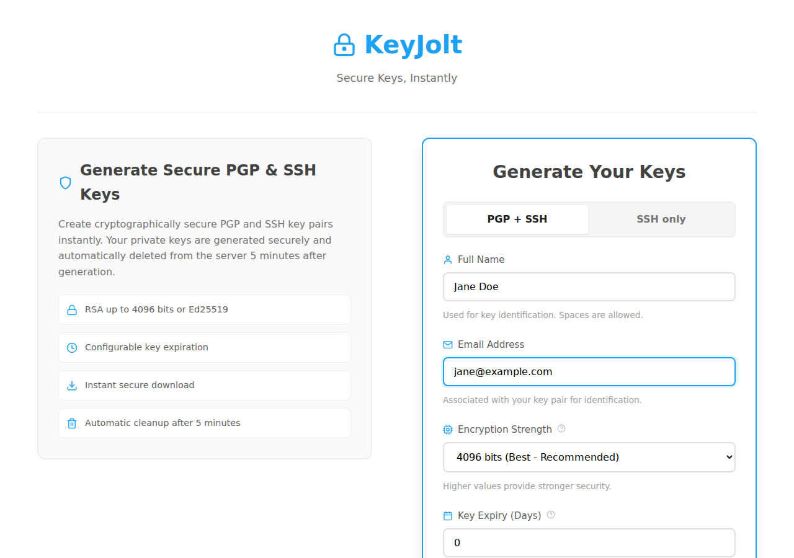
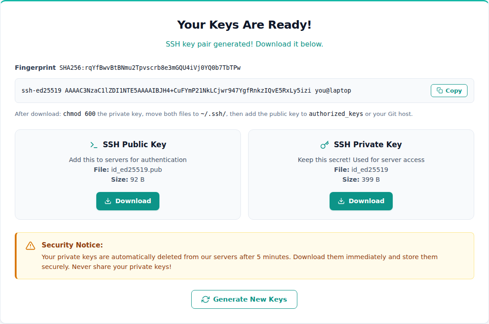

# 🔐 KeyJolt

<div align="center">
  <a href="https://github.com/hexawulf/KeyJolt/actions/workflows/ci.yml"></a>
  
  
  
  
  
</div>

<div align="center">
  <h3>🚀 Secure Keys, Instantly</h3>
  <p>A modern, secure web application for generating PGP and SSH key pairs with automatic cleanup and rate limiting.</p>
</div>

---

## 📸 Screenshots

<p align="center">
  
</p>
<p align="center">
  
</p>

## 🆕 What's New in v1.3.0

- **Fixed: "Generate New Keys" and "Try Again" did nothing.** They were inline `onclick`
  handlers that the app's own Content Security Policy blocks; they are now bound from the script.
- **Accessible dialogs.** About, Security and Privacy are real dialogs (`role="dialog"`,
  `aria-modal`); focus moves in, stays in on Tab, and returns on Escape, backdrop click or close.
  Progress and errors are announced to screen readers; tooltips open on keyboard focus.
- **Clearer errors** for a busy server (`503`, with the `Retry-After` wait), rate limits (`429`)
  and invalid download links.
- **About** shows `Erling Wulf Weinreich (0xWulf) · dev@0xwulf.dev`; the version comes from the build.
- **Tests and CI:** 101 JUnit tests (new `PgpKeyServiceTest`, `HealthControllerTest`), a JaCoCo
  gate of 80 % line coverage, a Playwright browser smoke suite in [`e2e/`](e2e/), a Trivy scan of
  every library in the built JAR, and SHA-pinned GitHub Actions on Node 24.

Older releases: see [CHANGELOG.md](CHANGELOG.md).

---

## ✨ Features

### 🔒 **Security First**
- **RSA Encryption**: Support for 2048, 3072, and 4096-bit key strengths
- **Automatic Cleanup**: Generated keys are securely deleted after 5 minutes
- **Unguessable Download Links**: Per-request random 128-bit token in every download URL
- **Rate Limiting**: 10 requests per hour with burst capacity protection
- **Security Headers**: Comprehensive HTTP security headers (HSTS, CSP, X-Frame-Options)
- **Secure File Handling**: Private keys are overwritten with random data before deletion

### 🎨 **Modern UI/UX**
- **Responsive Design**: Mobile-first approach with clean, minimal interface
- **0xWulf Teal Theme**: Clean minimal aesthetic with the canonical teal accent palette (`#14B8A6` / `#0D9488`)
- **Real-time Validation**: Live form validation with clear error messages
- **Progress Indicators**: Loading states and generation progress feedback
- **Tooltips**: Helpful explanations for technical concepts

### 🔑 **Key Generation**
- **PGP Key Pairs**: RSA-based PGP keys with configurable expiration
- **SSH Key Pairs**: Alongside PGP, or on their own (SSH-only mode: Ed25519 or RSA 4096, optional passphrase)
- **Custom Metadata**: User name and email integration
- **Flexible Expiry**: Keys can expire from 1 day to 10 years (or never)

### 🛡️ **Enterprise Ready**
- **Spring Security**: Comprehensive security configuration
- **Input Validation**: Server-side and client-side validation
- **Error Handling**: Graceful error management and user feedback
- **Logging**: Detailed security and operation logging

---

## 🏗️ Tech Stack

### **Backend**
- **Framework**: Spring Boot 4.1.2 (Java 17)
- **Language**: Java 17
- **Security**: Spring Security with custom headers
- **Cryptography**: Bouncy Castle (PGP), Apache MINA sshd-common (SSH)
- **Rate Limiting**: Bucket4j
- **Build Tool**: Maven

### **Frontend** 
- **Template Engine**: Thymeleaf
- **Styling**: Custom CSS with CSS Grid and Flexbox
- **JavaScript**: Vanilla JS with modern ES6+ features
- **Icons**: Feather Icons
- **Responsive**: Mobile-first design patterns

### **Security & Performance**
- **HTTPS Ready**: Security headers for production deployment
- **CSP**: Content Security Policy for XSS protection
- **Rate Limiting**: Token bucket algorithm
- **Memory Management**: Automatic resource cleanup

---

## 🚀 Quick Start

### Prerequisites
- Java 17 or higher
- Maven 3.6+

### Installation

1. **Clone the repository**
   ```bash
   git clone https://github.com/hexawulf/KeyJolt.git
   cd KeyJolt
   ```

2. **Build and verify the application**
   ```bash
   mvn -B verify
   ```

3. **Run the server**
   ```bash
   java -jar target/keyjolt-1.3.0.jar
   ```

4. **Access the application**
   ```
   http://127.0.0.1:5005
   ```

### Configuration

Defaults live in `src/main/resources/application.properties` and can be overridden via environment variables or Spring Boot CLI flags:

```properties
# Server Configuration (loopback by default; override with PORT / SERVER_ADDRESS or CLI flags)
server.port=${PORT:5005}
server.address=${SERVER_ADDRESS:127.0.0.1}

# Rate Limiting
app.rate-limit.requests-per-hour=10
app.rate-limit.burst-capacity=5

# Behind a reverse proxy that sets X-Real-IP (nginx): true = limit per client.
# Leave false when exposed directly, or clients could spoof their IP.
app.trusted-proxy=false

# File Cleanup (milliseconds)
app.key-cleanup-delay=300000

# Encryption Defaults
app.encryption.default-strength=4096
app.encryption.max-expiry-days=3650
```

See [DEPLOYMENT.md](DEPLOYMENT.md) for reverse-proxy and process-manager examples. **Do not** commit secrets to version control.

---

## 📖 Usage

### Generating PGP Keys

1. **Keep the toggle on "PGP + SSH"** and fill out the form with your name and email address
2. **Select encryption strength** (2048, 3072, or 4096 bits)
3. **Set key expiry** (0 for never expires, or 1-3650 days)
4. **Optionally enable SSH key generation**
5. **Click "Generate Keys"** and wait for processing
6. **Download your keys** immediately (they're deleted after 5 minutes)

### Generating SSH Keys Only

1. **Switch the toggle to "SSH only"** (or open `/#ssh`)
2. **Choose a key type**: Ed25519 (recommended) or RSA 4096
3. **Optionally add a comment and a passphrase**
4. **Click "Generate SSH Key"**, then copy the public key or download both files

### API (for scripts)

```bash
curl -s -X POST https://keyjolt.dev/api/generate/ssh \
  -H 'Content-Type: application/json' \
  -d '{"keyType":"ed25519","comment":"you@laptop"}'
# → { "success": true, "fingerprint": "SHA256:…", "publicKey": "ssh-ed25519 AAAA… you@laptop",
#     "files": [ { "filename": "id_ed25519.pub", "downloadUrl": "/download/<token>/id_ed25519.pub", … },
#                { "filename": "id_ed25519",     "downloadUrl": "/download/<token>/id_ed25519", … } ] }
```

Download links work for 5 minutes after generation; then the files are overwritten and deleted.

### File Naming Convention

Generated files follow this pattern:
- **PGP Public**: `email_name_pubkey_KEYID.asc`
- **PGP Private**: `email_name_seckey_KEYID.asc`
- **SSH Public**: `email_name_ssh_pub.key`
- **SSH Private**: `email_name_ssh_priv.key`
- **SSH-only mode**: `id_ed25519` / `id_ed25519.pub` or `id_rsa` / `id_rsa.pub`

All files are served from `/download/<request-token>/<filename>`.

---

## 🧪 Testing

```bash
# Unit + integration tests, JaCoCo report and 80 % line-coverage gate, SpotBugs, package
mvn -B verify
# Coverage report: target/site/jacoco/index.html

# Browser smoke tests (Playwright, Chromium) against the JAR just built
cd e2e
npm ci
npx playwright install chromium
npm run test:e2e        # boots target/keyjolt-*.jar on 127.0.0.1:5095 with its own temp/log dirs,
                        # stops it with SIGTERM, fails if a key file or download token survives
npm run test:e2e:live   # read-only checks against https://keyjolt.dev (never generates keys)
npm run screenshots     # refreshes docs/screenshots/*.png
```

CI (`.github/workflows/ci.yml`) runs all three stages on every pull request and push to `main`:
Maven verify, a Trivy scan of the built JAR (fails on fixable CRITICAL findings), and the
Playwright suite against that JAR.

---

## 🏛️ Architecture

### Project Structure
```
keyjolt/
├── src/main/java/com/keyjolt/
│   ├── KeyjoltApplication.java          # Spring Boot main class
│   ├── config/
│   │   ├── SecurityConfig.java          # Security headers, CSP, route allow-list
│   │   └── RequestLoggingFilter.java    # Request log (download paths redacted)
│   ├── controller/
│   │   ├── KeyController.java           # Generation, download and validation endpoints
│   │   └── HealthController.java        # GET /healthz
│   ├── service/
│   │   ├── PgpKeyService.java          # PGP key generation
│   │   └── SshKeyService.java          # SSH key generation
│   ├── model/
│   │   ├── KeyRequest.java             # Request DTO (PGP + SSH)
│   │   ├── SshKeyRequest.java          # Request DTO (SSH only)
│   │   └── KeyResponse.java            # Response DTO
│   └── util/
│       └── FileUtils.java              # Secure file operations
├── src/main/resources/
│   ├── templates/
│   │   └── index.html                  # Main UI template
│   ├── static/
│   │   ├── css/style.css              # Styling
│   │   └── js/script.js               # Frontend logic
│   └── application.properties          # Configuration
├── src/test/java/com/keyjolt/          # JUnit 5 tests (JaCoCo-gated)
├── e2e/                                # Playwright smoke suite (Node, separate from Maven)
├── docs/screenshots/                   # README screenshots
└── pom.xml                            # Maven dependencies
```

### Security Model

- **Stateless Sessions**: No server-side session storage
- **CSRF Protection**: Disabled for API endpoints (stateless design)
- **Rate Limiting**: Per-IP token bucket with hourly limits
- **File Security**: Per-request token directories, 0600 private keys, automatic cleanup with secure deletion
- **Input Validation**: Both client and server-side validation

---

## 🔒 Security Considerations

### **Production Deployment**
- Use HTTPS via a reverse proxy in front of loopback (`127.0.0.1:5005`)
- Pass `--app.trusted-proxy=true` only when the proxy overwrites `X-Real-IP`
- Configure proper firewall rules and graceful shutdown (`>= 15 s` stop timeout)
- Set up monitoring against `/healthz` and keep dependencies updated

### **Key Safety**
- Private keys are generated server-side and deleted 5 minutes after generation (and on every restart)
- No keys are logged or permanently stored
- Users must download keys immediately
- Secure random number generation used throughout

### **Rate Limiting**
- Default: 10 requests per hour per IP
- Burst capacity: 5 requests per minute
- Configurable via application properties

---

## 🤝 Contributing

1. Fork the repository
2. Create a feature branch (`git checkout -b feature/AmazingFeature`)
3. Commit your changes (`git commit -m 'Add some AmazingFeature'`)
4. Push to the branch (`git push origin feature/AmazingFeature`)
5. Open a Pull Request

---

## 📝 License

This project is licensed under the MIT License - see the [LICENSE](LICENSE) file for details.

---

## 👨‍💻 Author

**Erling Wulf Weinreich (0xWulf)**
- Email: dev@0xwulf.dev
- GitHub: [@hexawulf](https://github.com/hexawulf)

---

## 🙏 Acknowledgments

- [Bouncy Castle](https://www.bouncycastle.org/) for robust cryptographic libraries
- [Spring Boot](https://spring.io/projects/spring-boot) for the excellent framework
- [Feather Icons](https://feathericons.com/) for beautiful, lightweight icons
- [Apache MINA sshd](https://mina.apache.org/sshd-project/) for OpenSSH key generation

---

<div align="center">
  <p>Made with ❤️ for secure key generation</p>
  <p><strong>KeyJolt</strong> - Secure Keys, Instantly</p>
</div>